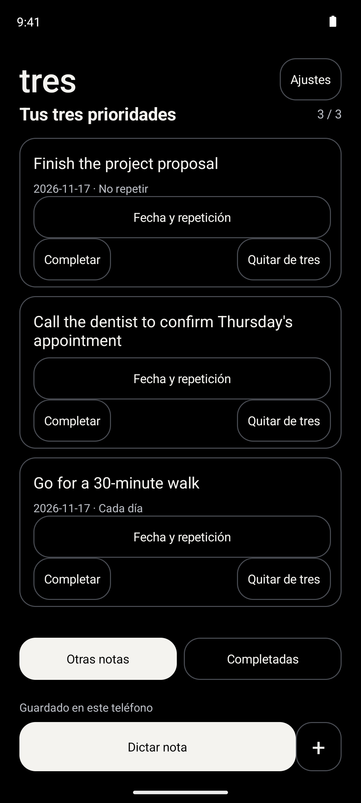
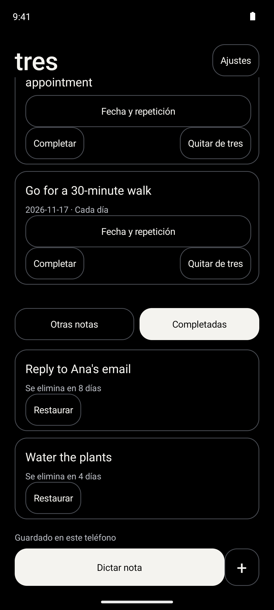
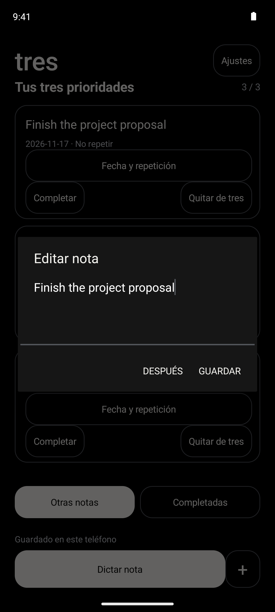
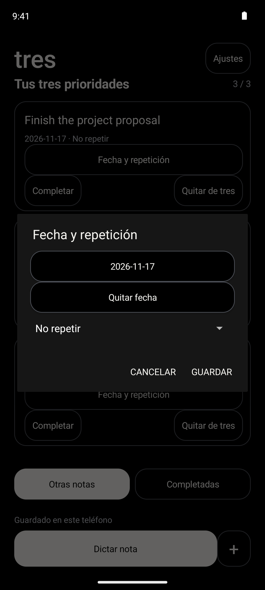

# Tres

**A minimal Android notes app that keeps your three priorities at hand.**

Capture a thought by voice or text, pick up to three priorities, and keep them on your home screen. Pure black AMOLED design, fully offline, no account.

<p align="center">
  
  
  
  
</p>

## Features
- **Three priorities.** Pin up to three notes so what matters stays on top.
- **Voice dictation** in Spanish or English, using Android's speech service.
- **Due dates and repetition**: daily, weekly or monthly. Completing a repeating task creates the next occurrence; monthly tasks keep their day (Jan 31 → Feb 28 → Mar 31).
- **Completed notes** stay for 10 days, so you can restore them, and then clean themselves up.
- **Home screen widget** showing your three priorities: complete them or start a dictation in one tap.
- **Delete notes** you no longer need, with a confirmation step.
- **Draft recovery.** Unsaved text is kept if you leave the editor.
- **Private by design.** Notes are stored only on your phone: no account, no cloud, no tracking, no notifications.

## Download
Get the latest `Tres-x.y.z.apk` from **[Releases](../../releases/latest)**, open it on your phone and allow installing from unknown sources if Android asks. Requires **Android 8.0** or newer.

## Build from source
Requirements: JDK 17 and Android SDK platform 34.

```sh
./gradlew assembleDebug        # APK in app/build/outputs/apk/debug/
./scripts/test-core.sh         # domain tests, no device needed
./gradlew connectedDebugAndroidTest   # storage tests on a device or emulator
```

On Windows use `gradlew.bat` and `scripts\test-core.ps1`. Every push is built and tested by GitHub Actions, and changes to the app are launched on an Android emulator that captures the screenshots above.

## Project structure
| File | Purpose |
|---|---|
| `app/src/main/java/app/tres/notes/Notebook.java` | Priorities, repetition and retention rules |
| `app/src/main/java/app/tres/notes/Note.java` | Immutable note model |
| `app/src/main/java/app/tres/notes/NoteStore.java` | Atomic JSON storage with backward-compatible loading |
| `app/src/main/java/app/tres/notes/MainActivity.java` | Main screen, editor, scheduling and dictation |
| `app/src/main/java/app/tres/notes/PriorityWidget.java` | Home screen widget |
| `tests/` | JVM regression tests for the domain logic |

## Privacy
Tres stores text only, in the app's private storage. It never stores audio; Android's speech service may process dictation online depending on your device settings. Uninstalling the app or clearing its data deletes your notes.
